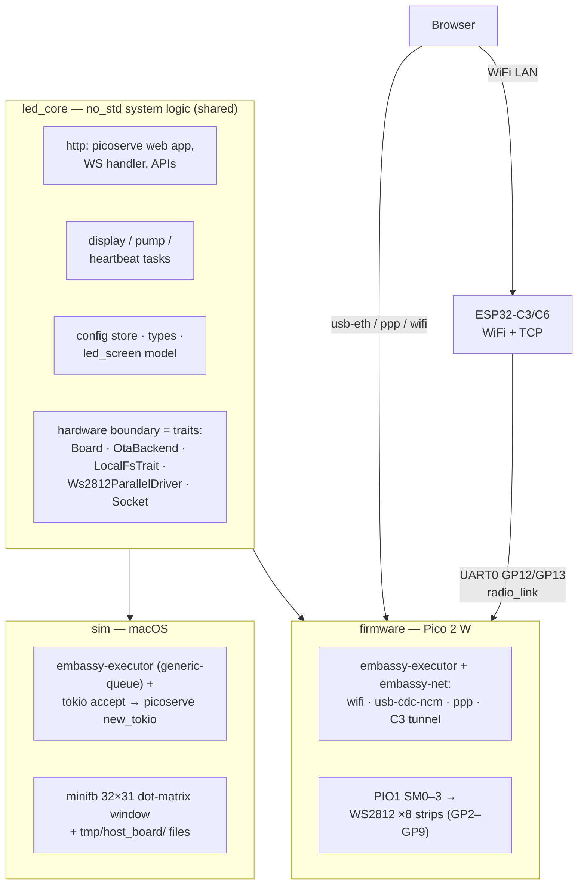

# LED Art Board

Rust firmware for a Raspberry Pi Pico 2 W (RP2351) LED art board: 8 parallel
WS2812 strips driven by PIO, a picoserve web UI with WebSocket control, config
and OTA over HTTP, and an optional ESP32-C3/C6 slave-radio transport. The
whole system logic lives in `led_core` and runs **unmodified on the Mac** —
`just sim` opens a dot-matrix window of the real matrix driven by the same
firmware tasks, serving the real web UI at `http://localhost:8080`.

- Agent / build / flashing notes: [`AGENTS.md`](AGENTS.md)
- ESP32 slave radio (wiring, architecture, provisioning): [`docs/slave-radio.md`](docs/slave-radio.md)

## Architecture



| Crate | Role |
|---|---|
| `led_core/` | all system logic (web app, tasks, config, screen model), platform-agnostic |
| `firmware/` | Pico 2 W hardware impl: PIO WS2812, flash stores, `Board` impls, transports |
| `sim/` | macOS full-system simulator + `animation_dev` scratchpad (`just sim`) |
| `radio_link/` | shared framed protocol between Pico and ESP32 slave radio |
| `slave_radio/` | ESP32-C3/C6 firmware (esp-hal), own workspace |
| `embedded_tools/` | `LocalFs` on Pico flash + the log facade (defmt on embedded, println on host) |
| `ws_client/` | host-side WebSocket client |

Task bodies are plain async fns shared by both platforms — the firmware and
the sim run identical logic against different trait implementations.

## Pinout: Pico 2 W

Left column = GP0–GP15 side; right column = VBUS side. Pin 1 (VBUS) is the
top-right corner.

| Left   | Use                    | Right  | Use               |
|--------|------------------------|--------|-------------------|
| GP0    | —                      | VBUS   | → radio VIN (5 V) |
| GP1    | —                      | VSYS   | —                 |
| GND    | —                      | GND    | ← radio GND       |
| GP2    | STRIP 0                | EN     | —                 |
| GP3    | STRIP 1                | 3V3    | —                 |
| GP4    | STRIP 2                | VREF   | —                 |
| GP5    | STRIP 3                | GP28   | —                 |
| GND    | —                      | GND    | —                 |
| GP6    | STRIP 4                | GP27   | —                 |
| GP7    | STRIP 5                | GP26   | —                 |
| GP8    | STRIP 6                | RUN    | —                 |
| GP9    | STRIP 7                | GP22   | —                 |
| GP10   | —                      | GP21   | —                 |
| GP11   | —                      | GP20   | —                 |
| GP12   | radio link TX (UART0)  | GP19   | —                 |
| GP13   | radio link RX (UART0)  | GP18   | —                 |
| GND    | —                      | GND    | —                 |
| GP14   | —                      | GP17   | —                 |
| GP15   | —                      | GP16   | —                 |

Strips 0–7 on GP2–GP9 (PIO1, WS2812 at 5 V). The radio link is UART0 at
460800 baud — GP12 → the radio's RX pin, GP13 ← its TX; the full C3/C6
wiring is in [`docs/slave-radio.md`](docs/slave-radio.md). GP0/GP1 are
spare (alternate UART0 pads for a debug console). On `wifi` builds GP23/24/25/29
are consumed by the cyw43.

## Quick start

```sh
just sim            # macOS simulator: window + web UI at http://localhost:8080
just main           # interactive fzf picker: transport, network → build → flash → attach
just radio-flash    # ESP32 slave radio firmware (see docs/slave-radio.md)
```
