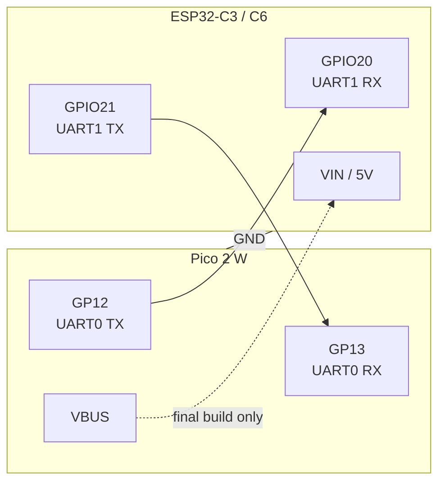
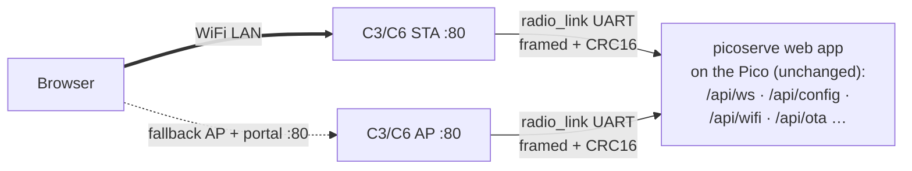

# ESP32 slave radio — **RETIRED** (Nov 2026)

> **Status:** the ESP32-C3/C6 slave-radio mode is retired and will probably
> never be used again. The Pico's own cyw43 Wi-Fi passed the acceptance suite
> (`scripts/stress_wifi.sh`) at 7–10× the relay's throughput, so `wifi` is the
> board's network path. This file is kept as the complete forensics record of
> the experiment — **do not deploy against it**, do not port dependencies for
> it. The code stays in-tree (`slave_radio/`, `radio_link/`, the firmware
> `radio` feature still compiles) as history.

Pico-side pinout: top-level [`README.md`](../README.md).

## Wiring



460800 baud, 8N1 (`radio_link::BAUD`). GPIO20/21 are UART1's default pads on
the C3 and valid UART1 matrix pins on the C6, so the firmware (`slave_radio/`,
one codebase, `esp32c3`/`esp32c6` features) wired both chips identically.
921600 tested clean-by-CRC at single loads but tripped ~1 mid-frame corruption
per 10–15 loads on this bench's jumpers — the link stayed at 460800.

> **Bench note:** while each board is plugged into a computer, **omit the VIN
> wire** and power both from their own USB — back-feeding 5 V into an already
> USB-powered radio board can trip the port's protection (this killed the C3's
> USB enumeration whenever the link wiring was attached; revisit on a known-good
> board). VIN belongs to the final build only, where the radio draws its 5 V
> from the Pico's VBUS rail.

The C3 draws < 350 mA peak from that rail; if you inject 5 V into the strip's
rail, power the radio from the same supply instead of VBUS. Any ESP32-C3 with
≥ 4 MB flash works (GPIO8 drives the SuperMini status LED, active-low). On the
C6-Zero bench: join + DHCP verified end-to-end (Leighhack, WPA2); double-check
that GPIO20/21 are broken out on your header before wiring the link — the C6's
GPIO matrix can move UART1 to any free pins (`with_tx`/`with_rx` in
`slave_radio/src/bin/slave_radio.rs`) if they aren't).

C3/C6 GPIO8: status LED (active-low). GPIO18/19: USB (console). C6 **GPIO9**
is the OTA boot-guard input (BOOT strap; held low across reset = flip A/B
slot) — do not wire elsewhere. Avoid GPIO 2/8/11 for new wiring (boot
strapping) and 26–31 (flash).

## Architecture



The radio owns WiFi entirely:

* joins the strongest saved network; on failure it falls back to an open
  AP + DHCP/captive-DNS portal (`http://192.168.2.1/`) with a WiFi-connect UI
* mDNS: `led-board.local` on whichever interface is up
* persists saved networks in flash (`cfg` partition), kept in sync with the
  Pico's `config.json` (Pico config wins at boot; Pico pushes on every save)
* the built-in portal answers `/api/wifi` (scan/join) locally while the Pico's
  full app is still reachable through the fallback AP via the relay

Everything the Pico needs from the radio (scan, join, status, LED) travels as
JSON RPC over the same link; browser connections are relayed as multiplexed
byte streams — see [`radio_link/src/lib.rs`](../radio_link/src/lib.rs) for the
framing spec. The C6 drains the UART with its UHCI DMA engine and stream data
is windowed (TCP-style cumulative acks), so the relay is lossless: buffer
pressure pauses the producer instead of dropping bytes.

Pico ran **no IP stack** in `radio` mode; the C3/C6 terminated TCP and relayed
sockets to picoserve on the Pico. Provisioning API (`/api/wifi`, `/api/status`,
`/api/networks`, `/api/forget`) was answered by the C3/C6 itself so the portal
worked even with the Pico unpowered. AP-mode routing: the **Pico app owned
`/` whenever it was online** (full web UI over the relay in AP mode too);
provisioning lived at `/setup`, and captive probes redirected there — or
straight to the app when mode was explicitly `AccessPoint` (the AP exists to
serve the UI then; fallback-AP pops still landed on setup for repair). With the
board offline, the portal reclaimed `/` for recovery. (`portal::route` claimed
only probes/OPTIONS/`/setup`/`/favicon.ico`/the five API paths — anything
else relayed, including WebSockets and `/api/ota`.) In pure `AccessPoint`
mode the supervisor never joined: `/setup` "Connect" only saved credentials;
joining resumed when mode returned to Station.

## Building (retired)

```sh
cd slave_radio && cargo build --release                    # C3
cd slave_radio && cargo build --release --no-default-features \
    --features esp32c6 --target riscv32imac-unknown-none-elf  # C6-Zero
```

The C3 `.cargo/config.toml` pins the target; for the **C6** pass it explicitly
— its config default does not match (C6 is `imac`, C3 is `imc`).
`slave_radio/` is a **detached workspace** (excluded from the root workspace,
own `Cargo.lock` + `.cargo/config.toml`) — host tests must be run from the
repo root or cargo picks up the RISC-V target and fails to link.

C3/C6 firmware size ≈ 690 KB (~17% of app partition, ~338 KB of ~400 KB RAM).
Pico `radio` build: 536,232 B after the Nov 2026 frame-mirror drop (legacy;
see AGENTS.md sizes for live builds).

## Flashing — C6 / C3 (retired)

```sh
just radio-flash    # build + espflash flash --partition-table partitions.csv (explicit!)
```

- **Never trust `cargo flash` here**: the `runner`'s `--partition-table` flag is
  silently ignored, and the chip gets the *default* table (factory app at
  `0x10000`) — which **collides with the `cfg` journal** also at `0x10000`.
  `partitions.csv` gotchas: esp-idf-part rejects custom data subtypes like
  `0x40` (use `undefined`); `espflash erase-region` takes positional
  `<addr> <size>`; wipe stored WiFi config with
  `espflash erase-region 0x10000 0x4000`.
- Flashes over the C6's **native USB-JTAG** port (`/dev/cu.usbmodem…`,
  `espflash list-ports` finds it). ~7 s for the ~690 KB image.
- `espflash board-info -p <port>` is a safe health check; it ends with a
  hard-reset back into the app.
- Config store lives in flash at `0x10000` (`cfg` partition). Factory config
  boots into AP **"LED Board"** at `192.168.2.1` (mDNS `led-board.local`),
  captive portal included; saved-network failures fall back to the same AP.
- `scripts/flash_both.sh` automated C6 + Pico flashing with BOOTSEL polling.

### A/B partition table + radio OTA

`partitions.csv`: nvs(0x9000) / otadata(**0xd000**) / phy / cfg(0x10000,
unchanged) / **ota_0@0x20000** / **ota_1@0x210000**, each `0x1F0000` (~2 MB);
no factory app. espflash confirms the custom table with app capacity
**2,031,616** (= `0x1F0000`).

USB flash on this table **must name the slot** and clear otadata for a
deterministic boot (both were built into `scripts/flash_both.sh` and the
`radio-flash`/`radio-c6-flash` just recipes):

```sh
espflash flash --partition-table partitions.csv --target-app-partition ota_0 …
espflash erase-region -p <port> 0xd000 0x2000   # empty otadata → boots ota_0
espflash reset -p <port>
```

**OTA over the network**: `just radio-ota` — builds the C6 image,
`espflash save-image --chip esp32c6 <ELF> tmp/radio.bin`, then
`curl POST /api/ota-radio` to the board's IP. The C6 streams the image into
the *inactive* slot (`src/ota.rs`), flips otadata, reboots; `GET
/api/ota-radio` returns `{version, slot, update_writes_to}` — check `slot`
flipped. STA acceptor peeked the request head and served the ota-post
*locally even when the Pico was offline*; `/api/ota-radio` was portal-claimed
so it also worked on the fallback AP (POST via phone won't work — needs the
ELF — but GET status does).

- **Boot confirm/rollback hatch**: the app marked the running slot `Valid` at
  boot (after `esp_rtos::start`, before anything touches flash).
  The prebuilt bootloader has **no auto-rollback**, so a bootable-but-broken
  image stayed booted — the manual recovery was to **hold GPIO9 (C6 BOOT strap,
  input-pull-up after boot) LOW across a reset**: the boot guard then flipped
  otadata to the other slot and reboots. C6-Zero may have no physical button
  — bridge GPIO9→GND before power-up/reset, or just re-flash over USB.
- The OTA write holds the **store mutex** for the whole upload (~30 s on
  WiFi): the journal and portal API block meanwhile — by design; the chip
  reboots at the end regardless.
- Don't `erase-region 0xd000` while inspecting slot state after an OTA —
  that resets selection to ota_0.

## Monitoring — C3/C6 (retired quirks)

- Console was USB-JTAG (`esp-println` `jtag-serial` feature — do **not** move
  it to UART0: UART0's default pins GPIO20/21 are the link pins to the Pico).
- Native USB-JTAG **enumeration drops on every chip reset**. A monitor
  attached across a reset saw nothing. **Opening** the port also reset the
  chip (DTR auto-reset circuit) — exploit it: with `cat` attached, every
  reconnect replayed the boot sequence live.
- Logs emitted while no host was attached were dropped (esp-println is
  non-blocking by design, 64-byte FIFO) — and second-stage bootloader logs
  filled that FIFO before the app printed anything. Consequence: **panics were
  invisible on a cold boot**. Bring-up scaffolding existed in
  `src/bin/slave_radio.rs`: a 6 s boot delay + `stage:` `println!` breadcrumbs
  + a 5 s `hb:` heartbeat (mode/ap_up/joined/pico_online/rx counters/heap_free)
  so attaching a listener showed exactly where boot stalled. Capture pattern:
  `cat /dev/cu.usbmodemNNN & sleep 16; kill %1`.
- mDNS: `led-board.local` took ~5 s to resolve from this Mac — scripting ran
  against the C6's DHCP IP instead.
- **Never touch the Mac's WiFi** (`networksetup -setairportnetwork` …) — it is
  the agent's own uplink; AP-mode tests ran from the user's phone while the
  Mac stayed on the LAN.
- Log level was baked at build time from `ESP_LOG` in
  `slave_radio/.cargo/config.toml` `[env]` (= info). Changing it required a
  rebuild.
- `espflash monitor` needs a real TTY (fails when piped). For scripted capture
  use `script -q out.log <cmd>` or `/usr/bin/expect`.
- Killing the terminal mid-`cat /dev/cu.usbmodem…` can orphan a `cat` that
  holds the port; `pkill -f 'cat /dev/cu'` if espflash can't open it.

## Protocol notes (retired)

- **UART frames**: `[0xBEEF][type u8][stream u16][len u16][crc16 LE][serde_json]`,
  defined once in `radio_link/` — both sides changed together, `HelloInfo`
  version checks bumped when the wire format changed. Protocol v3:
  `STREAM_ACK` frames (payload: cumulative u32 LE **frames** consumed) window
  stream data at `radio_link::STREAM_WINDOW_FRAMES` (4 frames) un-acked per
  stream per direction. The window counts **frames, not bytes** (v2's 8 KB
  byte window let small frames — 15 B HTTP header writes — pipeline more
  frames than the queue has slots → burst overruns and truncation): queue
  depth is derived from the same constant on both sides, so overflow was
  unreachable for any frame sizes. 4 frames ≈ 90 ms of buffering at 460800 —
  throughput stayed line-rate bound. The link was **lossless by construction**:
  `FRAME_TX.send` blocked (never dropped), and any anomaly (CRC fail, overrun,
  30 s without acks) closed *that stream* — one retriable request, never
  silent corruption. Don't re-add timeout/drop heuristics; that was the
  pre-v2 bug (pages truncated at ~16 KB).
- **Heap bounds on the radio**: stream queues were per-frame heap `Vec`s inside
  the C3/C6's 112 KB heap. Worst case (slots × pool × 1 KB + `FRAME_TX`
  backlog) once OOM-panicked the chip — a WiFi disconnect mid-load brought up
  the fallback AP, and the APSTA combo mode pins tens of KB (measured: idle
  AP+STA `heap_free` ≈ 9 KB vs 19 KB STA-only). The supervisor disabled
  the fallback AP after a successful STA join (Station mode; ApStation kept
  it) via an APSTA→STA `set_config`. The `hb:` heartbeat logged `heap_free` —
  floor during the 4-way burst suite ≈ 14 KB.
  The global allocator was **TLSF** (`ESP_ALLOC_CONFIG_HEAP_ALGORITHM` in
  `.cargo/config.toml`) — the default LLFF list allocator OOM-panicked mid-
  suite while `heap_free` still read ~10 KB (fragmentation: a 1 KB flash-write
  scratch found no contiguous block). Changing the value needs `cargo clean -p
  esp-alloc`. `heap_free` is a *sum* — it can lie while the largest free block
  is tiny; suspect fragmentation first when small allocs fail.
- **read_head buffering rules** (`slave_radio/src/httpd.rs`): the acceptor
  peeked the request head on every connection (STA *and* AP) so `/api/ota-radio`
  was served by the radio itself. Consequences remembered: (1) `parse_head`
  must slice the head in BYTES before `from_utf8` — a POST prefix carries
  binary body and UTF-8-failing-the-whole-buffer silently became `GET /` and
  relayed firmware uploads to the Pico (404); (2) bodies > 4096 B are NOT
  buffered into `prefix` (a growing prefix realloc OOM-panicked the chip
  mid-upload; `ota::update` and the relay stream the rest from the socket);
  (3) connections not starting with an HTTP method token are RST'd — stale
  same-4-tuple retransmits from an aborted upload otherwise land as the next
  connection's head (poisoned `GET /` relays, identical truncated responses
  run after run). Big uploads: curl POSTs to a flaky link landed in `just
  radio-ota`'s retry loop by design (writes to the inactive slot are
  idempotent from offset 0).
- **Socket budgets**: `StackResources<N>` in `src/bin/slave_radio.rs` was the
  smoltcp **max socket count per stack** (AP: dhcp + dns + mdns + 2
  acceptors + clients → 12; STA: mdns + 3 acceptors + clients → 16). Exceeding
  it panics (`SocketSet full`).
- **Acceptance harness (radio era)**: `./scripts/stress.sh` — captured both
  consoles, waited for the STA lease to answer (preflight), ran 3 single +
  3×4-burst page loads, then required one sha256 group, 0 curl failures, and 0
  `corrupt|gap|overran|timeout|abort` trips in either log. Pico build used
  `--features radio,defmt_tcp,console` (the USB console carried the guard
  logs; C6 port = the non-bench `/dev/cu.usbmodem*`). Superseded by
  `scripts/stress_wifi.sh`.

## Dependency state at retirement

- **esp-hal stayed at tag `esp-hal-v1.1.2`**; v1.2.0 existed (Sep 2026) but
  the port would have been a full radio session: typed `Ssid`/`Password` +
  `AuthenticationMethodConfig` configs, `DmaAlignedMut` descriptor buffers,
  `SoftwareInterruptControl` removed, `esp_radio::wifi::new` renamed,
  `Interface` lifetime changes. Never done — the radio mode is retired.
