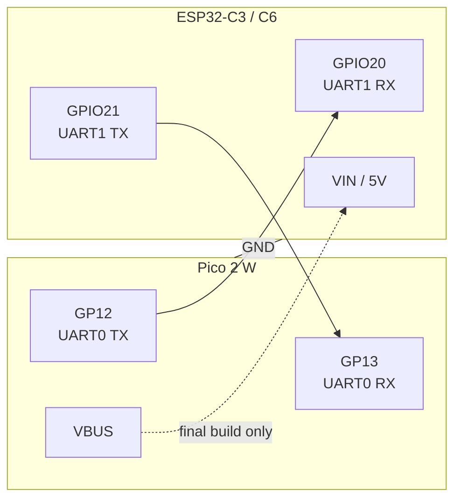
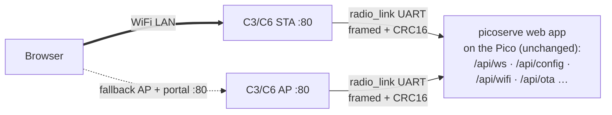

# ESP32 slave radio (optional, `radio` build)

The cyw43 WiFi on the Pico 2 W is flaky in some environments, so the firmware
has a `radio` build where an ESP32-C3 **or ESP32-C6** acts as the board's
radio: it owns WiFi, terminates TCP, and relays browser connections to the
Pico over one UART. The Pico itself then runs **no IP stack at all**.

Pico-side pinout: top-level [`README.md`](../README.md).
Build recipes, flashing, A/B partitions and OTA workflow live in
[`AGENTS.md`](../AGENTS.md) ("Flashing — ESP32-C6 / C3").

## Wiring



460800 baud, 8N1 (`radio_link::BAUD`). GPIO20/21 are UART1's default pads on
the C3 and valid UART1 matrix pins on the C6, so the firmware (`slave_radio/`,
one codebase, `esp32c3`/`esp32c6` features) wires both chips identically.

> **Bench note:** while each board is plugged into a computer, **omit the VIN
> wire** and power both from their own USB — back-feeding 5 V into an already
> USB-powered radio board can trip the port's protection (this killed the C3's
> USB enumeration whenever the link wiring was attached; revisit on a known-good
> board). VIN belongs to the final build only, where the radio draws its 5 V
> from the Pico's VBUS rail.

The C3 draws < 350 mA peak from that rail; if you inject 5 V into the strip's
rail, power the radio from the same supply instead of VBUS. Any ESP32-C3 with
≥ 4 MB flash works (GPIO8 drives the SuperMini status LED, active-low). On the
C6-Zero bench: join + DHCP verified end-to-end (Leighhack, WPA2); double-check
that GPIO20/21 are broken out on your header before wiring the link — the C6's
GPIO matrix can move UART1 to any free pins (`with_tx`/`with_rx` in
`slave_radio/src/bin/slave_radio.rs`) if they aren't.

## Architecture



The radio owns WiFi entirely:

* joins the strongest saved network; on failure it falls back to an open
  AP + DHCP/captive-DNS portal (`http://192.168.2.1/`) with a WiFi-connect UI
* mDNS: `led-board.local` on whichever interface is up
* persists saved networks in flash (`cfg` partition), kept in sync with the
  Pico's `config.json` (Pico config wins at boot; Pico pushes on every save)
* the built-in portal answers `/api/wifi` (scan/join) locally while the Pico's
  full app is still reachable through the fallback AP via the relay

Everything the Pico needs from the radio (scan, join, status, LED) travels as
JSON RPC over the same link; browser connections are relayed as multiplexed
byte streams — see [`radio_link/src/lib.rs`](../radio_link/src/lib.rs) for the
framing spec. The C6 drains the UART with its UHCI DMA engine and stream data
is windowed (TCP-style cumulative acks), so the relay is lossless: buffer
pressure pauses the producer instead of dropping bytes.

## Running the board with the slave radio

```sh
just radio-flash   # build + flash the radio firmware (partition table!)
just main          # choose network "radio" in the fzf picker
```

Once the radio answers HELLO, the Pico pushes its saved WiFi networks (or
adopts the radio's when its own config is empty). Connect to
`http://led-board.local/` as before — the web app, WebSocket control, and OTA
all work unchanged. OTA for the radio itself: `just radio-ota`.
